# Microsoft Entra ID User Lifecycle Lab

   

Onboarding employees and an outside contractor into Microsoft Entra ID for a fictional company, CamachoCorp, keeping their access separate, hardening how users authenticate, then offboarding the contractor and proving it in the audit logs. Everything runs on the Entra ID Free tier.

> [!NOTE]
> All users and the company are fictional. Personal email addresses, the tenant domain and tenant IDs are blurred in every screenshot.

## Contents

- [Scenario](#scenario)
- [Environment](#environment)
- [Build](#build)
- [Lessons learned](#lessons-learned)
- [Findings](#findings)
- [Repository layout](#repository-layout)

## Scenario

CamachoCorp onboards three IT employees and one external contractor. Employees and the contractor need different, separately managed access. When the contract ends, the contractor's access has to be removed completely, with evidence.

## Environment

| Item | Value |
|---|---|
| Directory | Microsoft Entra ID (Free tier), administered with a Global Administrator account |
| Employees (Members) | John Doe (104), Juan Sanchez (105), Stephanie Clancy (106) |
| Contractor (Guest) | Matthew Valencia (107c) |
| Groups | `IT Department` (employees), `IT Contractors` (contractor) |
| Naming convention | UPN follows the employee ID, e.g. `az104-user1` for employee 104 |

## Build

### 1. Create internal users

**Entra ID → Manage → Users → New user → Create new user**

- Created the three employees as **Members** with auto-generated temporary passwords that must be changed at first sign-in, so the admin never knows a user's real password.
- John Doe's account carries the full job profile: title, company, department, employee ID, employee type and hire date. In production, every account would get complete HR data, usually from an HR system.

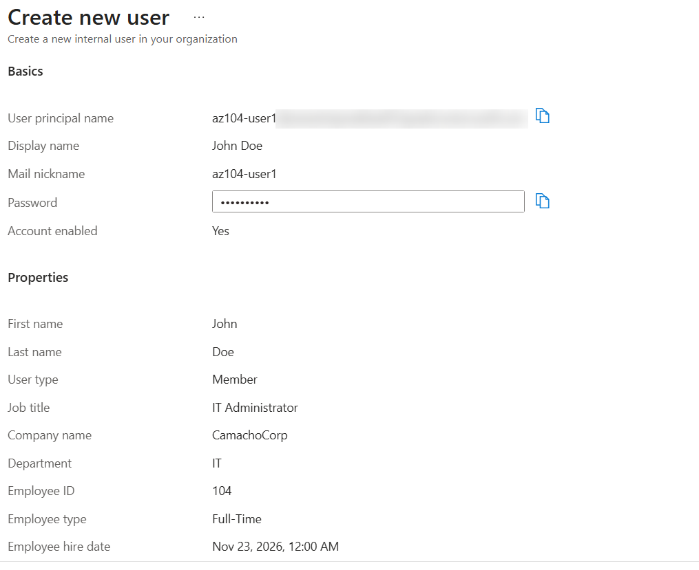

### 2. Invite the contractor as a guest

**Users → New user → Invite an external user**

Invited the contractor by email with a welcome message. He signs in with his own identity (B2B collaboration) and shows as **User type: Guest** with an `#EXT#` UPN.

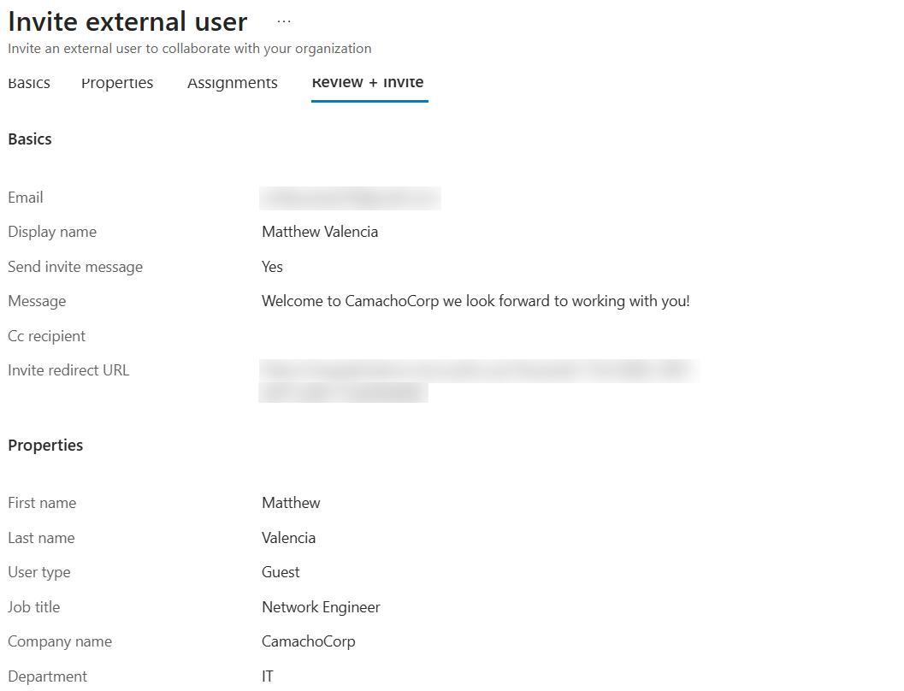
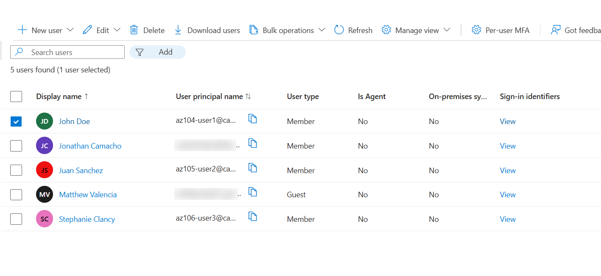

### 3. Create the IT Department group

**Manage → Groups → New group**

| Setting | Value |
|---|---|
| Group type | Security |
| Membership | Assigned (dynamic membership needs Entra ID P1/P2) |
| Owner | Administrator account |
| Members | John Doe, Juan Sanchez, Stephanie Clancy |

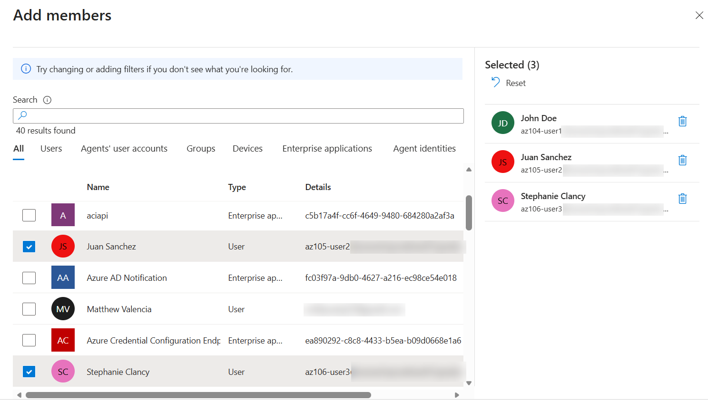

### 4. Create the IT Contractors group

A separate **Security** group, described as temporary access that is reviewed regularly and removed at contract end, with the contractor as its only member. Contractor access can now be granted, reviewed and removed without touching employees.

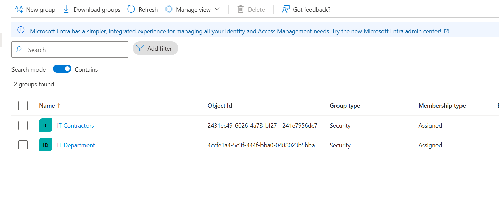

### 5. Configure the Authentication methods policy

**Entra ID → Security → Authentication methods → Policies**

| Method | Setting | Reason |
|---|---|---|
| Microsoft Authenticator | On, all users | Main MFA method; used by security defaults |
| Passkey (FIDO2) | On, all users | Phishing-resistant |
| Temporary Access Pass | On, IT Department only | Admin-issued, for onboarding and recovery |
| SMS / Voice call | Off | Weakest methods: phishable, open to SIM swapping |
| Software OATH tokens | Off | Redundant with Authenticator; codes can be phished |
| Password / Email OTP | On | Users still sign in with passwords; guests may use email OTP |

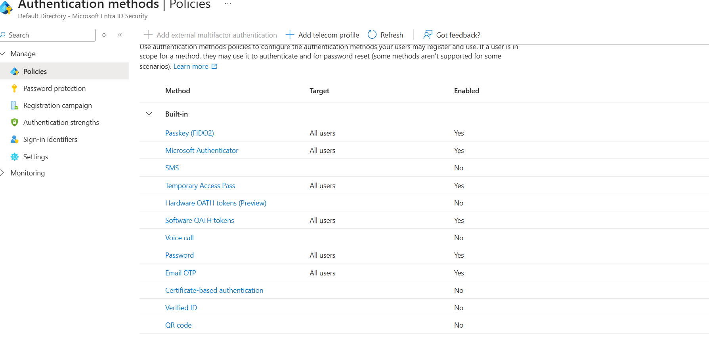
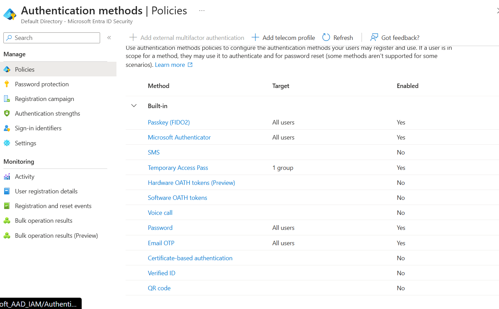

### 6. Scope and harden the Temporary Access Pass

- **Target:** IT Department only. Guests authenticate through their home organization, so the contractor group was removed.
- **Lifetime:** 1 hour (minimum, maximum and default)
- **One-time use:** Yes
- **Length:** 15 characters (default is 8)

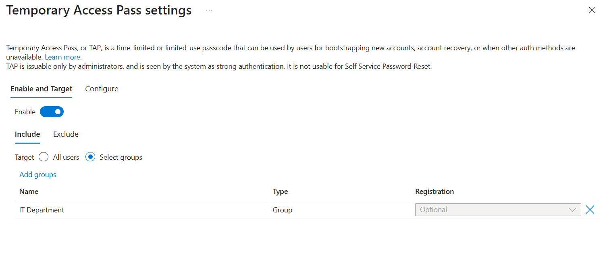
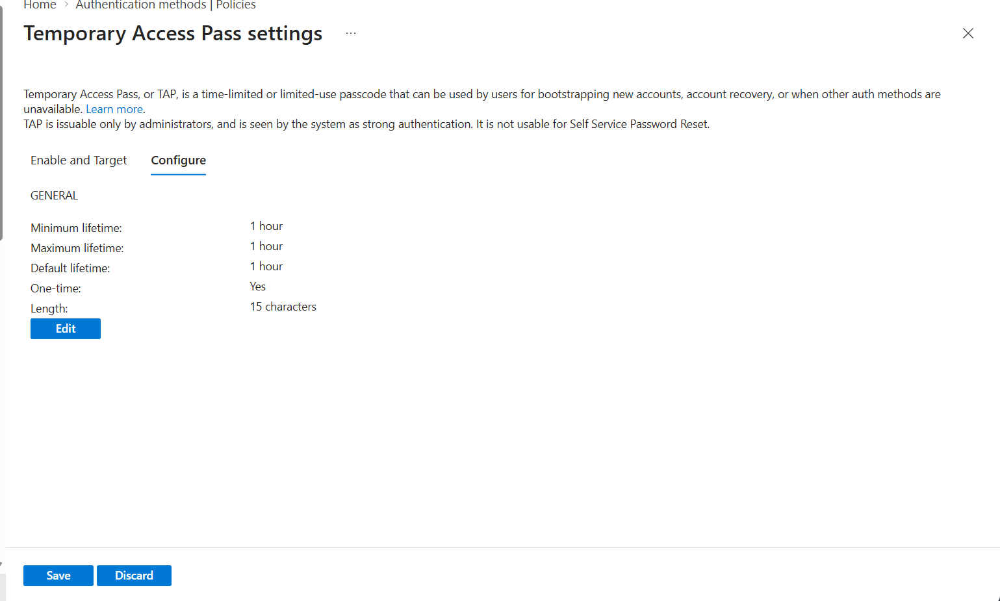

### 7. Offboard the contractor

1. **Block sign-in:** Users → Matthew Valencia → Edit properties → Settings → uncheck **Account enabled** → Save
2. **Revoke sessions:** Overview → **Revoke sessions** → Yes. Disabling alone leaves existing sessions open.
3. **Remove access:** Groups → IT Contractors → Members → **Remove**

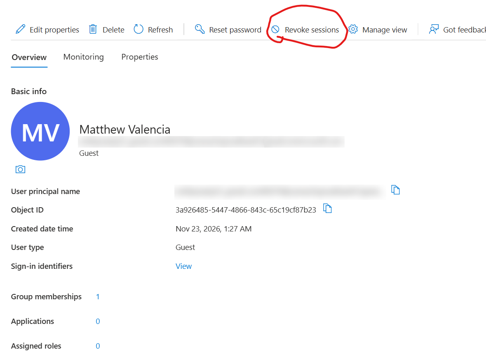

### 8. Verify in the audit logs

**Entra ID → Monitoring → Audit logs**

| Activity | What it proves |
|---|---|
| `Disable account` | Sign-in blocked |
| `Update StsRefreshTokenValidFrom` | Sessions revoked (tokens issued before this time are invalid) |
| `Remove member from group` | Access to IT Contractors removed |

The Target(s) tab identifies the user and group by **Object ID**, which matched the contractor's and the IT Contractors group's IDs. The actor's Object ID matched the admin account.

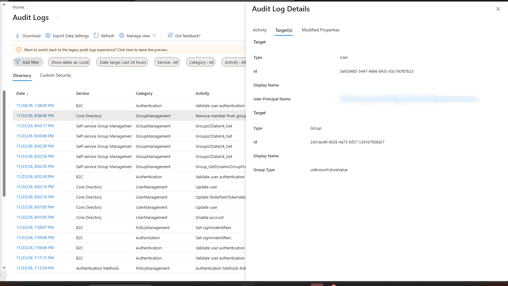

> [!IMPORTANT]
> Entra ID Free keeps audit logs for 7 days. Capture evidence right after the change.

## Lessons learned

- **Contractor in the employee group.** I first selected the guest along with the employees for IT Department. Caught it before creating the group and gave him his own contractor group.
- **TAP scoped too wide.** I first targeted both IT groups. Guests don't need a tenant-issued pass, so I removed IT Contractors.
- **Almost locked users out.** While editing the methods policy, I turned off Microsoft Authenticator and passkeys. With security defaults requiring Authenticator, that could have blocked sign-ins. Re-enabled both before signing out.
- **Blank display names in audit logs.** Audit entries identify objects by Object ID and UPN, not display name, so I confirmed the evidence by matching IDs.

## Findings

- The tenant flagged a migration from the legacy MFA/SSPR policies to the converged Authentication methods policy. The modern policy is configured; the migration status still needs confirming.
- The admin account is an external identity (`#EXT#`) because the tenant was created with a personal Microsoft account. A second, internal Global Administrator is better practice.
- Access reviews and risk-based Conditional Access need Entra ID P2; dynamic groups need P1 or P2.
- Global Administrator controls Entra ID, but Azure subscription and billing pages need a separate Azure (RBAC) role.

## Repository layout

```text
Entra-User-Lifecycle-Lab/
├── README.md
├── Entra-User-Lifecycle-Lab-Full-Writeup.pdf   # step-by-step write-up, 30 figures
├── Entra-User-Lifecycle-Lab-Condensed.pdf      # 4-page summary
└── screenshots/
```
