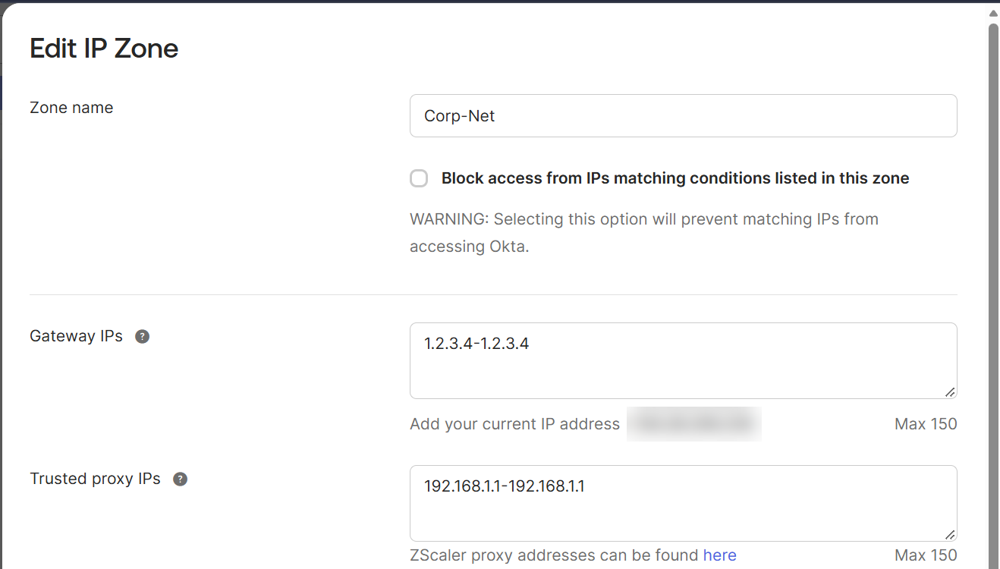
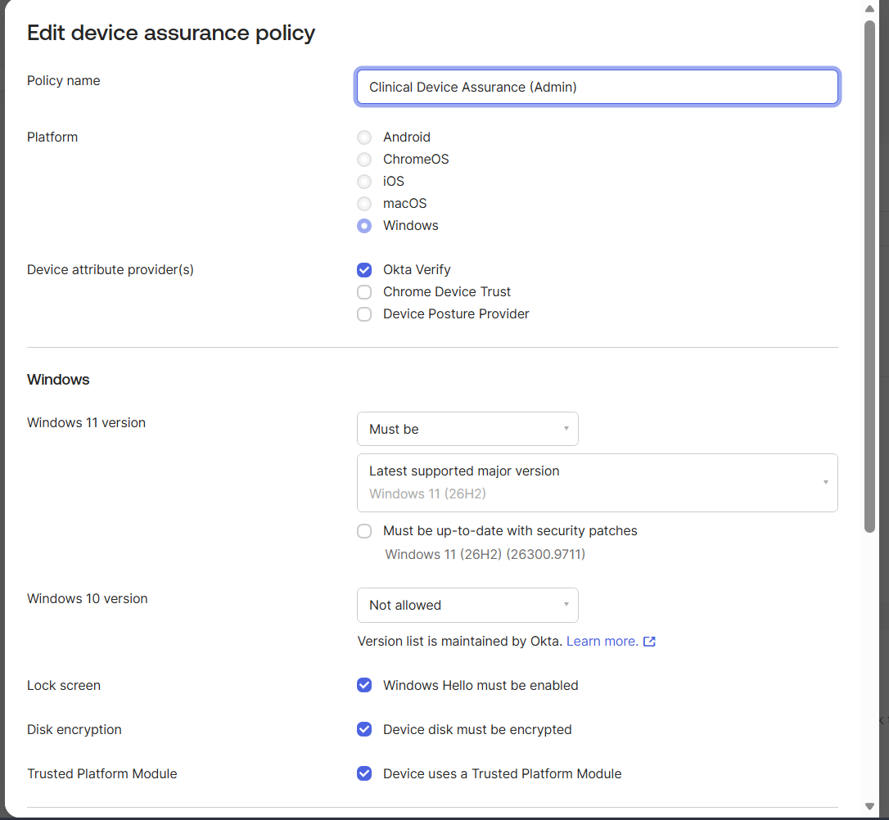
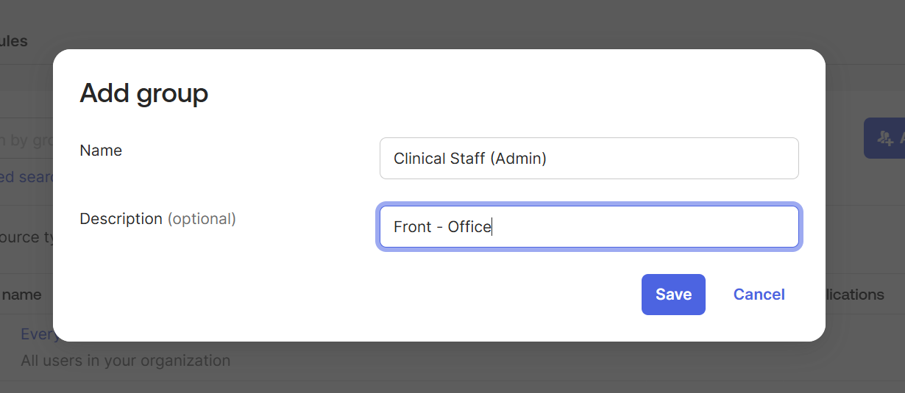
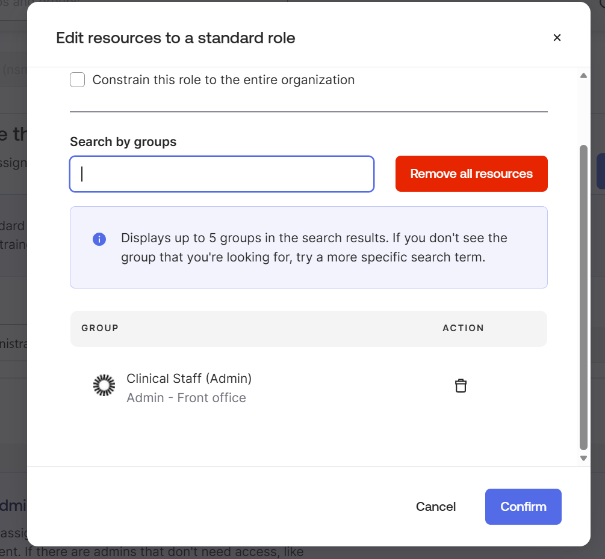
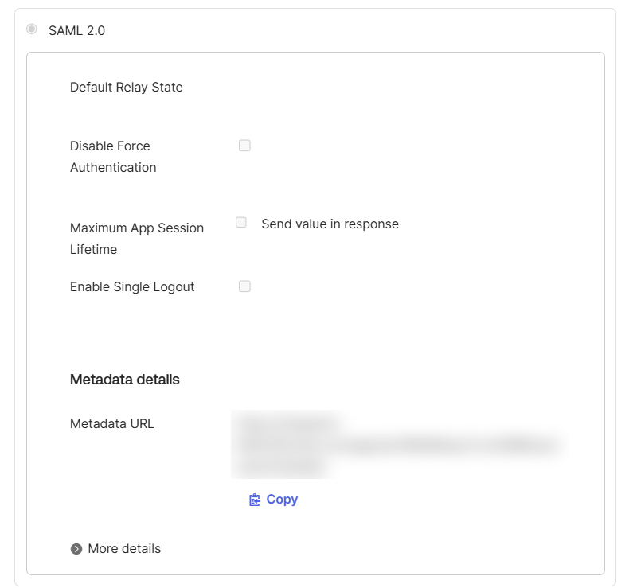
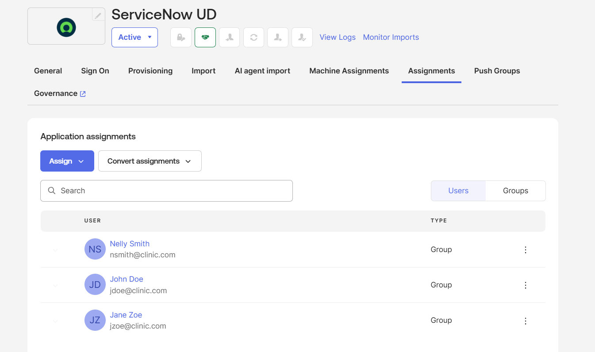
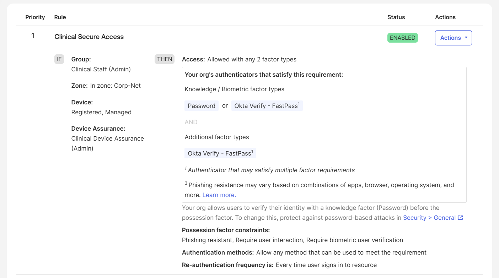
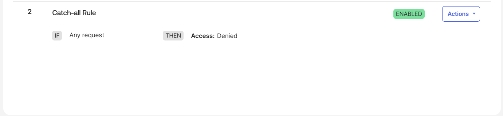
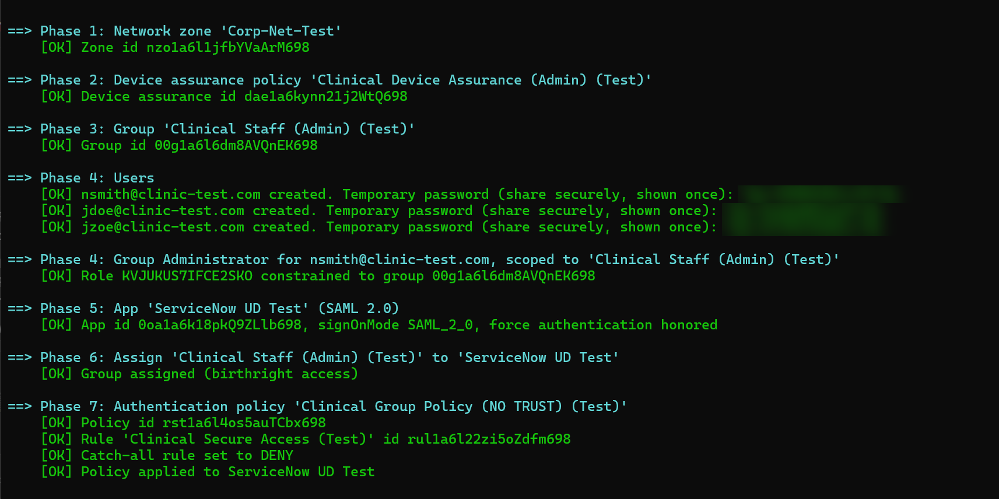

# Okta Zero Trust Onboarding Lab

   

Onboarding a clinic's front-office team into Okta and giving them access to ServiceNow only when every security condition is met. The build was done by hand in the Admin Console first, then automated with a PowerShell script against the Okta Management API.

> [!NOTE]
> All IP addresses, URLs, users and domains in this lab are placeholder data.

## Contents

- [Scenario](#scenario)
- [Access model](#access-model)
- [Build](#build)
- [Automation](#automation)
- [Lessons learned](#lessons-learned)
- [Repository layout](#repository-layout)

## Scenario

Three front-office staff need ServiceNow from their first day. No user, device or network is trusted by default: access is granted only after identity, device health, network location and phishing-resistant MFA are all verified on every sign-in.

## Access model

| Check | Requirement | Okta object |
|---|---|---|
| Identity | Member of the front-office role group | Group `Clinical Staff (Admin)` |
| Device | Registered, managed, Windows 11 (latest supported), Windows Hello, disk encryption, TPM | Device assurance `Clinical Device Assurance (Admin)` |
| Network | Signing in from inside the corporate network | Network zone `Corp-Net` |
| MFA | Two factors, phishing-resistant, biometric, every sign-in | Sign-in rule `Clinical Secure Access` |
| Everything else | **Denied** | Catch-all rule |

## Build

### 1. Network zone

Created the IP zone `Corp-Net` (gateway `1.2.3.4`, proxy `192.168.1.1`). Network location is one signal in the policy; on its own it never grants access.



### 2. Device assurance policy

Windows only. Windows 11 must be on the latest supported major version, Windows 10 is not allowed, and Windows Hello, disk encryption and a TPM are required.



### 3. Role-based group

Created `Clinical Staff (Admin)`. Access is attached to the group, so every member gets exactly what the role needs (birthright access), and moving someone out of the role removes it.



### 4. Users and a scoped group admin

- Created three users in the group with temporary one-time passwords they must change at first sign-in, so the admin never knows a user's real password.
- Assigned the **Group Administrator** role to one user individually, constrained to `Clinical Staff (Admin)` only, not the whole organization.



### 5. ServiceNow with SAML 2.0

Added **ServiceNow UD** from the catalog, selected **SAML 2.0** instead of SWA so the password never leaves Okta, and unchecked **Disable Force Authentication** so re-authentication requests from ServiceNow are honored.



### 6. Group-to-app assignment

Assigned the group, not individual users, to ServiceNow. Each user shows `Type: Group`, which confirms the access came from the role.



### 7. Authentication policy

Created the app sign-in policy `Clinical Group Policy (NO TRUST)` with one allow rule:

| Rule setting | Value |
|---|---|
| Group membership | At least one of: Clinical Staff (Admin) |
| Device state / management | Registered / Managed |
| Device assurance | Clinical Device Assurance (Admin) |
| Network | In any of: Corp-Net |
| Authenticate with | Any 2 factor types |
| Possession constraints | Phishing resistant, user interaction, biometric verification |
| Re-authentication | Every time user signs in to resource |

Then set the **catch-all rule to Denied** and applied the policy to ServiceNow.




## Automation

[`scripts/Build-OktaZeroTrustLab.ps1`](scripts/Build-OktaZeroTrustLab.ps1) rebuilds the lab through the Okta Management API (the ServiceNow catalog app is added once by hand) and verifies the result. Objects are looked up by name first, so re-running it does not create duplicates.

### Usage

Requires PowerShell 7 and an Okta API token. The token is read from an environment variable and is never stored in the script. Run `Unblock-File` on the script first if Windows blocks it after download.

```powershell
$env:OKTA_ORG = "https://your-org.okta.com"
$env:OKTA_API_TOKEN = Read-Host "Okta API token" -MaskInput

./Build-OktaZeroTrustLab.ps1 -TestRun            # build a separate test copy
./Build-OktaZeroTrustLab.ps1 -TestRun -Cleanup   # delete only the test copy
```

| Switch | What it does |
|---|---|
| `-TestRun` | Adds a test suffix to every object name (for example `Corp-Net-Test`, `Clinical Staff (Admin) (Test)`, `ServiceNow UD Test`) and uses `@clinic-test.com` users, so the real lab is never touched |
| `-Cleanup` | Only valid with `-TestRun`; removes the test users, app, policy, group, device assurance policy and zone |

### Result

From a `-TestRun` build, which creates a separate copy with test names:

```text
==> Verification
Group assigned to app        True
Users in group               3
Admin role scoped to group   True
Force authn honored          True
Catch-all denies             True
```



### Known limitations

- Catalog apps such as ServiceNow UD can't be created through the API in this org. Add the app once in the Admin Console with the expected label; the script finds and configures it.
- The Windows Hello requirement in the device assurance policy is set in the console.

## Lessons learned

- **Group-level admin roles grant admin to every member.** I first assigned Group Administrator to the group itself, which made all three users admins. Moving the role to one user, scoped to one group, fixed it.
- **"Disable Force Authentication" is a double negative.** Unchecked is the secure setting.
- **Windows PowerShell 5.1 returns JSON arrays as a single object.** That broke list lookups and counts; the script now requires PowerShell 7.
- **Downloaded scripts are blocked by Windows** until `Unblock-File` is run.

## Repository layout

```text
.
├── README.md
├── Okta-Zero-Trust-Onboarding-Lab-Full-Writeup.pdf   # full step-by-step write-up
├── Okta-Zero-Trust-Lab-Condensed.pdf               # 5-page summary
├── scripts/
│   └── Build-OktaZeroTrustLab.ps1
└── screenshots/
```
